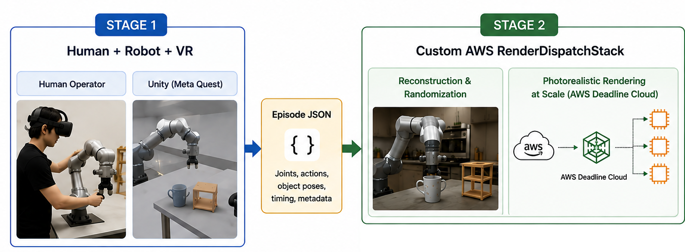

# From VR Teleoperation to Scalable Physical-AI Data Generation

A scalable pipeline for generating diverse, photorealistic robot training data from VR teleoperation demonstrations.

The core idea is to **decouple robot demonstration capture from visual data generation**. A demonstration is captured once as a replayable robot trajectory, then replayed in a digital environment to generate diverse visual observations through configurable scene randomization.

## Architecture

The workflow consists of two stages:

- **Stage 1 — VR Teleoperation:** Captures robot demonstrations using VR teleoperation and exports replayable robot trajectories. The teleoperation application is not included in this repository.
- **Stage 2 — Scalable Rendering and Data Generation:** Processes captured episodes, reconstructs the robot and environment in Blender, applies configurable domain randomization, and generates diverse visual training data using AWS infrastructure.

Stage 2 uses AWS orchestration, containerized processing, and AWS Deadline Cloud GPU workers to distribute rendering workloads.

A single demonstration can generate multiple visually distinct training samples, depending on the randomization parameters and settings selected by the user, while preserving the same trajectory and action labels.

## Repository Structure

- `stage2-render-dispatch/` — AWS CDK application and rendering pipeline for episode processing, scene reconstruction, domain randomization, and distributed rendering.
- `docs/` — Architecture diagrams and supporting documentation.

## Getting Started

### Prerequisites

Before deploying the rendering pipeline, prepare the following:

- An AWS Deadline Cloud farm and queue with a GPU fleet.
- A compatible Blender scene (`scene_twin.blend`).
- A compatible robot kinematic configuration (`rig.json`).
- Robot demonstration episode JSON files compatible with the pipeline.

The Blender scene and robot configuration are not included in this repository. The original scene contained third-party assets with separate licensing requirements, so these files have been excluded from the public sample.

Both `scene_twin.blend` and `rig.json` are mandatory runtime inputs. The Blender container downloads them from S3 for each episode. If either file is missing or incompatible, the rendering task will fail.

### Creating Your Own Blender Scene and Robot Configuration

You must provide two compatible files:

1. **`scene_twin.blend` — Robot and Environment**

   Create a Blender scene containing:

   - The robot's 3D geometry, with one Blender object per robot link.
   - The environment and objects required for the demonstration.
   - Two rendering cameras named `Cam_EyeInHand` and `Cam_Context`.

   For the SO-101, you can obtain the robot URDF and associated mesh assets from [TheRobotStudio/SO-ARM100](https://github.com/TheRobotStudio/SO-ARM100/tree/main/Simulation/SO101), or provide a URDF for your own robot.

   Import the robot into Blender using a compatible URDF import workflow. Ensure that all referenced mesh files are available and that the resulting Blender object hierarchy follows the expected robot link structure.

2. **`rig.json` — Robot Kinematic Configuration**

   Create a JSON file describing the robot's kinematic chain, including:

   - Robot link names and parent-child relationships.
   - Joint anchor transformation matrices.
   - Joint identifiers corresponding to the joint fields in the episode JSON.
   - The robot's base transformation and rest configuration.
   - The link names and hierarchy in `rig.json` must match the corresponding robot objects in `scene_twin.blend`. Both files must describe the same robot model and coordinate conventions.

See [`stage2-render-dispatch/README.md`](stage2-render-dispatch/README.md) for deployment instructions, configuration, and rendering workflow details.

## License and Third-Party Assets

The original code in this repository is licensed under the MIT-0 License. See [LICENSE](LICENSE) for details.

The MIT-0 license applies to the original code in this repository only. It does not grant rights to third-party robot models, URDF files, meshes, textures, Blender assets, or other external dependencies.

Users are responsible for obtaining and complying with the applicable licenses and attribution requirements for any external assets they use to create their Blender scenes.
