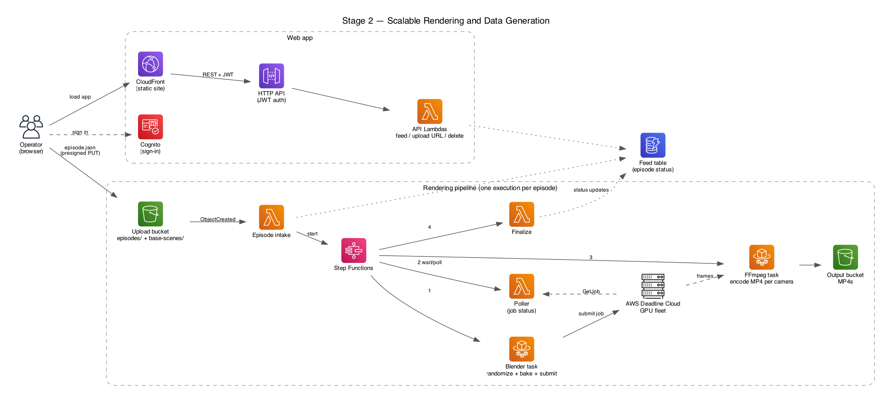

# RenderDispatchStack

**Stage 2 of a two-stage pipeline.** It takes episode JSON recordings produced by
Stage 1 (VR teleoperation, not included in this repository) and turns each one
into photorealistic training video, with no human in the loop.

## Design: Rendering Pipeline

Uploading an episode starts one **AWS Step Functions** execution:

**Episode JSON → Blender reconstruction (Fargate) → Deadline Cloud GPU rendering
→ FFmpeg encoding (Fargate) → MP4 in S3**

The demonstration is rebuilt in Blender from the recorded joint angles and object
poses, randomized, then rendered from the two cameras in the scene — an
eye-in-hand wrist camera and an over-the-shoulder context camera — and encoded to
one MP4 per camera. Each episode's status is tracked so progress and failures are
visible in the web app.



## Domain randomization

Each episode can vary camera pose, lighting, background, surface textures, and
distractor props, so one trajectory yields diverse training observations. Assets
for these come from you; all three kinds can be downloaded from
[Poly Haven](https://polyhaven.com/) (CC0). Upload them to `<UploadBucketName>`:

| asset | prefix in the upload bucket |
|---|---|
| PBR texture sets (`.zip`, keeping the `table_texture/` and `box_texture/` subfolders) | `base-scenes/blender_texture/` |
| distractor props (Blender `.blend.zip`) | `base-scenes/distractor/` |
| HDRI environments (`.exr` / `.hdr`), one subfolder per set | `base-scenes/background/<set>/` |

Every prefix is optional and every step is best-effort: whatever you upload is
used, and a step whose assets are missing or that doesn't apply to your scene is
logged and skipped rather than failing the episode.

HDRI environments replace the room rather than sitting behind it. The base scene
is a sealed room, so the shell and its ceiling fixtures are removed and the HDRI
becomes both the backdrop and the only light source. Group them into one subfolder
per set and point `BACKGROUND_PREFIX` (in `lib/render-dispatch-stack.ts`) at the
set you want, so several can live in the bucket at once:

```
base-scenes/background/factory/    auto_service_4k.exr, boiler_room_4k.exr, ...
base-scenes/background/hospital/   hospital_room_4k.exr, surgery_4k.exr
```

Put the `.exr` files directly in the set folder — the lookup scans one level only.

Environment, prop, and camera choices are seeded by the episode id, so
re-rendering an episode reproduces them while different episodes differ. The wrist
camera is never jittered, since a real wrist camera is rigidly bolted to the
gripper.

### Several renders from one episode

The **Variants** box in the upload form renders the same episode more than once,
each with its own environment, lighting, props, and camera pose — a demonstration
is expensive to collect and cheap to re-render.

Each variant is a separate execution with its own feed row and output folder
(`output/<episodeId>/v<i>/<Camera>.mp4`), so one failing doesn't affect the
others. Variants of an episode are given different environments, as long as you
have uploaded at least as many HDRIs as variants. Cost scales with the count — N
variants is N GPU renders — so it's capped at 10.

## Supplying Mandatory Assets

The rendering pipeline requires two input files in the upload bucket before the first render. Both files are downloaded by the Blender container at runtime for every episode. If either file is missing or incompatible, the rendering task will fail.

| File | S3 key | Description |
|---|---|---|
| `scene_twin.blend` | `base-scenes/scene_twin.blend` | Blender scene containing the robot's 3D geometry, environment, and the two rendering cameras. |
| `rig.json` | `base-scenes/rig.json` | Robot kinematic configuration describing the joint hierarchy, joint anchor transformations, and rest pose. |

Neither file is included in this repository. You must create or provide your own compatible files.

See the root [README](../README.md#creating-your-own-blender-scene-and-robot-configuration) for guidance on creating a Blender scene.

### Blender Scene Requirements (`scene_twin.blend`)

The Blender scene must contain:

- The robot's 3D geometry, with one Blender object per robot link.
- The environment and objects required for the demonstration.
- Two cameras named `Cam_EyeInHand` and `Cam_Context`, as referenced in `blender_twin/deadline_bundle/template.yaml`.

The scene serves as the visual representation of the robot and its environment. At runtime, the rendering pipeline applies the recorded episode's joint angles and object poses to generate the animation.

### Robot Kinematic Configuration (`rig.json`)

The `rig.json` file describes the robot's kinematic chain independently of its visual geometry. It defines how robot links are connected, their joint anchor transformations, and their rest configuration.

For the SO-101, the link names in `rig.json` must match the corresponding Blender object names. The robot's visual geometry and kinematic configuration must describe the same robot model.

Example structure:

```json
{
  "links": [
    {
      "name": "shoulder_link",
      "joint_key": "base",
      "parent": "base_link",
      "A_p": ["16 matrix values"],
      "A_c": ["16 matrix values"],
      "fixed": false
    }
  ],
  "base_world": ["16 matrix values"],
  "box": {}
}
```

`A_p` and `A_c` are row-major 4×4 joint anchor transformation matrices expressed in Unity coordinates (Y-up). A link's local pose at joint angle θ is calculated as:

`A_p · Rot_x(θ) · A_c⁻¹`

The joint angle is obtained from the episode field specified by `joint_key`.

For implementation details, see `blender_twin/episode_anim.py`.

### Uploading the Files

Once both files are prepared, upload them to the expected S3 locations:

```bash
aws s3 cp scene_twin.blend \
  s3://<UploadBucketName>/base-scenes/scene_twin.blend

aws s3 cp rig.json \
  s3://<UploadBucketName>/base-scenes/rig.json
```

**Important:** The Blender scene and `rig.json` must be compatible. Incorrect object names, joint definitions, or transformation matrices can cause animation and rendering failures.

## Prerequisites

Node.js and npm, configured AWS credentials, and an AWS Deadline Cloud farm and
queue with a GPU fleet.

## Deadline farm/queue ids (SSM)

The stack doesn't create the farm — it reads your farm and queue ids at runtime
from two SSM parameters, so set them once before the first render:

```bash
aws ssm put-parameter --name /render-dispatch/farm-id  --type String --overwrite --value <farm-id>
aws ssm put-parameter --name /render-dispatch/queue-id --type String --overwrite --value <queue-id>
```

## Deploy

Set a region for your shell first — the `aws` examples in this README omit
`--region`.

```bash
npm install                                  # install dependencies
npx cdk bootstrap -c region=<region>         # once per account + region
npx cdk deploy    -c region=<region>         # deploy the stack

# If the stack runs OUTSIDE the farm's region, name both regions so the
# Deadline calls still target the farm:
npx cdk deploy -c region=<region> -c deadlineRegion=<farm-region>
```

On success it prints `UploadBucketName` (episodes and assets go here),
`OutputBucketName` (rendered videos), `WebAppUrl`, `ApiUrl`, `StateMachineArn`,
and the Cognito `UserPoolId` / `UserPoolClientId`. Endpoint values are written to
a `config.json` the browser reads at runtime, so the web app needs no rebuild.

## Sign in and try it

Self sign-up is disabled, so create your user first (Cognito emails a temporary
password):

```bash
aws cognito-idp admin-create-user --user-pool-id <UserPoolId> \
  --username <email> --user-attributes Name=email,Value=<email> Name=email_verified,Value=true
```

Open the `WebAppUrl`, sign in and set a new password. Then upload an episode — it appears in the feed within seconds
and the render starts automatically.

A full episode can take up to about half an hour, depending on its frame count and
your GPU fleet's size and scaling. To check the app end to end quickly, tick
**Test render** and give it a small number of frames.

## Cleanup

```bash
npm run destroy
```

**The Deadline farm, queue and fleet survive** — they keep costing money until you
delete them yourself (fleet, then queue, then farm). The SSM parameters remain
too.
